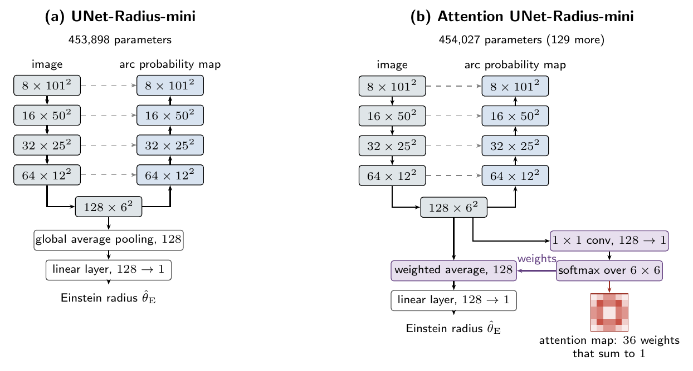

# AttentionRSA

U-Net models with an attention mechanism for strong gravitational lens classification and Einstein radius estimation
in *Euclid* images, and the code of the experiments for "*Attention to Physics: Interpretable Transfer Learning of the
Einstein Radius in Strong Lens Images*" (in preparation).



The U-Nets are pretrained on simulated images and fine-tuned on the real *Euclid* Q1 stamps of the
[EUCLID-SAGE](https://github.com/singularity4/EUCLID-SAGE) benchmarks. Network layers are compared with
representational similarity analysis (RSA), using representational dissimilarity matrices (RDMs).

| Model | Filters (first block to bottleneck) | Outputs | Parameters |
|---|---|---|---:|
| UNet-Starlight | 16, 32, 64, 128, 256 | arc mask, lens | 1,812,243 |
| Attention UNet-Starlight | 16, 32, 64, 128, 256 | arc mask, lens | 1,812,500 |
| UNet-Radius-mini | 8, 16, 32, 64, 128 | arc mask, Einstein radius | 453,898 |
| Attention UNet-Radius-mini | 8, 16, 32, 64, 128 | arc mask, Einstein radius | 454,027 |

## Quick Start

```bash
git clone https://github.com/singularity4/AttentionRSA.git
cd AttentionRSA
pip install -r requirements.txt
```

Tested with Python 3.13. A GPU is used if available.

## Data

- EUCLID-SAGE benchmarks (tables and stamps):
  ```bash
  git clone https://github.com/singularity4/EUCLID-SAGE.git ../EUCLID-SAGE
  export EUCLID_SAGE_BENCHMARK_DIR="$(cd ../EUCLID-SAGE/benchmarks && pwd)"
  ```
- `modeling_lens_mass.csv`: measured Einstein radii of the real lenses, from Zenodo record
  [15025832](https://doi.org/10.5281/zenodo.15025832); needed to fine-tune UNet-Radius-mini.
- The simulated training set (10,000 images, about 0.4 GB) is generated by `simulate.py`, the first step of
  `reproduce.sh`.

## Usage

```bash
bash reproduce.sh all              # all groups of networks
bash reproduce.sh radius           # one group: radius, radius-attention or starlight
bash reproduce.sh all --quick      # short test run
```

| Group | Networks | Copies | Fine-tuned on |
|---|---|---:|---|
| `radius` | UNet-Radius-mini | 10 | measured Einstein radii of the real lenses |
| `radius-attention` | Attention UNet-Radius-mini | 10 | measured Einstein radii of the real lenses |
| `starlight` | UNet-Starlight and Attention UNet-Starlight | 5 each | EUCLID-SAGE-1k-D |

Copies of the same network differ only in their initial weights (`--init-seed`).

| Script | Purpose |
|---|---|
| `simulate.py` | generates the simulated *Euclid* VIS images, with arc masks, Einstein radii and simulation parameters |
| `train_copies.py` | trains the U-Nets on the simulated images |
| `finetune_radius.py` | estimates the Einstein radii of the real lenses with UNet-Radius-mini (with and without attention): applied directly, fine-tuned, or trained from random weights |
| `finetune_lens.py` | fine-tunes UNet-Starlight (with and without attention) for lens classification on a real benchmark, and trains the same architecture from random weights for comparison |
| `compute_rdms.py` | computes the RDM of every layer of every network on simulated and real images |
| `compare_rdms.py` | compares the RDMs between networks and with image features |
| `models.py`, `data.py`, `metrics.py` | shared code: models, data loading and metrics |

Results are saved in `results/`, `rdms/` and `comparisons/`. All random seeds are fixed. Each script describes its
method, options and outputs at the top of the file.

## License

MIT

## Acknowledgements

The lenses are from the *Euclid* Q1 Strong Lensing Discovery Engine (Euclid Collaboration: Walmsley et al. 2026,
A&A 711, A26) and the images from the *Euclid* Q1 data release (Euclid Collaboration: Aussel et al. 2026); see the
[Euclid data credits](https://www.cosmos.esa.int/web/euclid/data-credits-acknowledgements). The simulations use
[`lenstronomy`](https://github.com/lenstronomy/lenstronomy).
